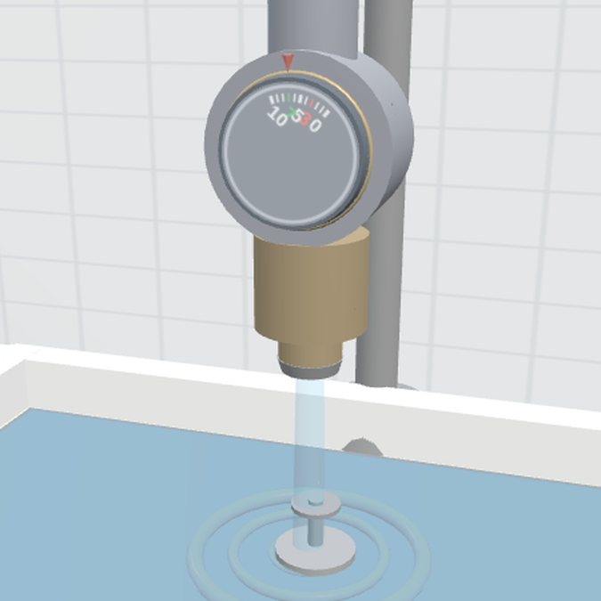

# TapTamer

**The clockwork tap timer — screws onto any kitchen or bathroom tap and shuts the water off by itself.**

Twist the dial to 3 or 7 minutes. Water flows while a wind-up clockwork counts down; at zero the valve snaps shut with a ding. No battery, no electronics, no "stay-on" position — you physically cannot leave the tap running.

## Try it in 3D

- **Live simulator:** once GitHub Pages is on, this repo serves it at
  `https://grimzeero78.github.io/Water/` (the page is `index.html`).
- **Offline:** just open `index.html` — it is a single self-contained file.

In the simulator: click **3 MIN** or **7 MIN**, or drag the brass dial. Watch the
mainspring, gear train, escapement and cam drum work in ghost view, then hear it
ding shut at zero. Press **STOP** (or twist back to zero) to close early.

## What's in this repo

| File | What it is |
|---|---|
| `index.html` | Interactive 3D simulator — timed runs, ghost-view mechanism, water usage readouts |
| `prototype.html` | All 6 printable parts, exploded / assembled, viewable in any browser |
| `stl/` | 3D-printable STL parts: 1 wet body, 2 poppet valve, 3 latch lever, 4 head drum, 5 dial knob, 6 cam drum |
| `build-guide.pdf` | Workshop manual: tools, materials, 9 build steps, tap fitting, calibration, troubleshooting, savings |
| `TapTamer.scad` | Parametric OpenSCAD source model (millimetres) |
| `guide-assets/` | Diagrams and renders used by the guide |

## How it works (pure mechanics)

1. **Twist** — winding the dial tensions the mainspring and latches the poppet valve open.
2. **Countdown** — a gear train and escapement release the spring slowly, one tick per second.
3. **Trip** — a cam drum rides down as the spring unwinds; at zero it releases the latch.
4. **Shut-off** — the closing spring snaps the valve shut. Every run *ends* closed.

There is no stay-on position: even the maximum 10-minute twist always ends with
the valve closed, so a forgotten tap can never flood the bucket, the cup or the bill.

## Fitting on your tap

Unscrew the aerator from the spout, wrap the spout thread with PTFE tape, and
screw TapTamer on hand-tight (max a quarter turn with a tool). Fits standard
M22 / M24 male spout threads; cheap adapters cover the rest. Your own aerator
screws back onto TapTamer's outlet.

## License

MIT — see [LICENSE](LICENSE).
