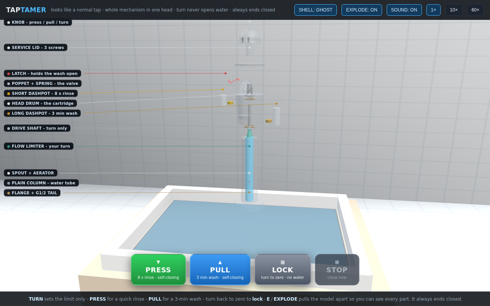
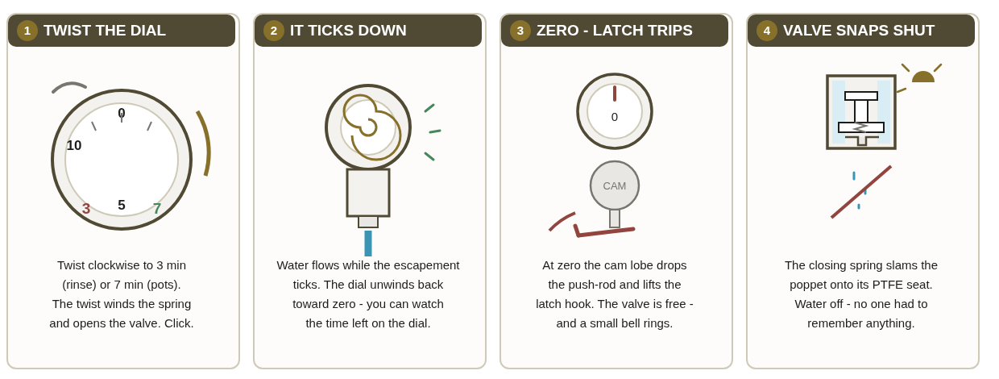
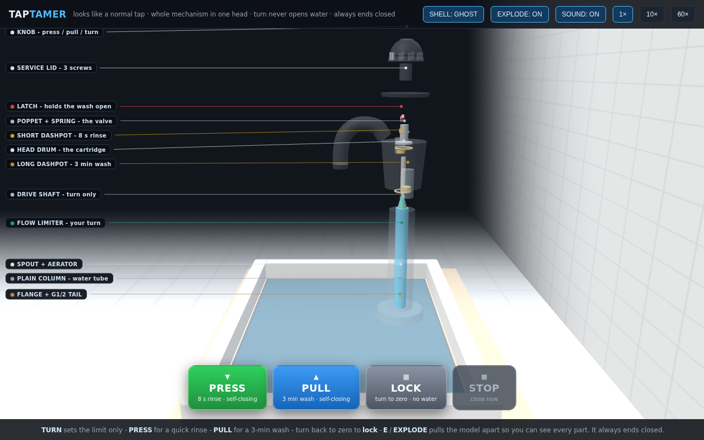
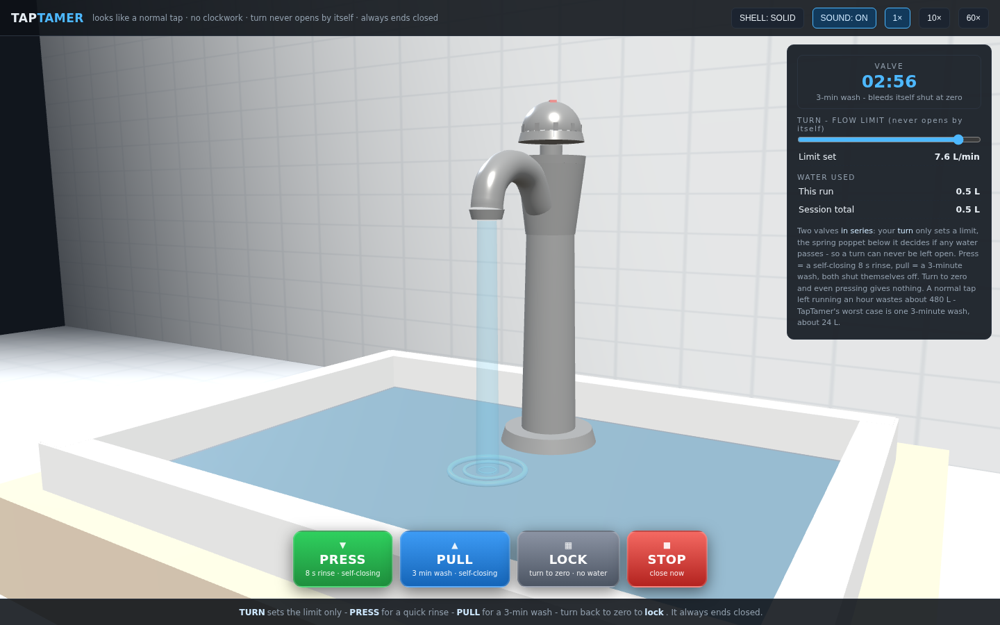

# 01 - How TapTamer Works

> Open the simulator and press **E** (or the **EXPLODE: ON** button) to pull the
> model apart while you read this. Every part gets a named callout pinned to the
> screen edge with a thin leader line pointing at the part - the labels never
> sit on top of the model, so nothing hides anything.



## The one-sentence version

TapTamer is a complete replacement pillar tap that looks and fits like a normal
tap, but the whole mechanism - two valves in series, two oil dashpots and a
latch - lives in **one cartridge inside the head**, so the tap can never be left
running and fitting it is just swapping the old tap.

## Why two valves instead of one

A normal tap has a single valve: open it, water flows, and it stays open until
a human closes it. TapTamer puts **two valves in series** (one after the other
in the water path), and this is the heart of the safety:

```
supply -> G1/2 tail -> plain column (just a tube)
       -> VALVE 1: flow limiter  <- your TURN only sets this
       -> VALVE 2: spring poppet <- press / pull moves this; spring closes it
       -> spout + aerator
```

* **Valve 1 - the flow limiter.** A needle cone on a seat. Turning the knob
  moves the cone up or down, which sets *how much* water may pass - nothing
  more. It has a square drive rod, but the rod cannot lift the cone off its
  seat, so **turning alone can never start a flow**.
* **Valve 2 - the spring poppet.** A PTFE-faced disc held onto its seat ring by
  a closing spring. It is the real open/close. Pressing the knob down lifts the
  disc; pulling the knob up latches it open. In every other state the spring
  pushes it shut.

The two together are the interlock: even if someone turns the knob fully open
and walks away, no water comes out, because the poppet behind it is still
spring-closed. To get water you must *press* or *pull* - actions that end.

## The three actions



| Action | What happens | How it ends |
|---|---|---|
| **Press** the knob down | Lifts the poppet for a quick rinse (about 8 s) | A short oil dashpot bleeds itself and the spring closes the valve |
| **Pull** the knob up | Latches the poppet open for a wash (about 3 min) | A long oil dashpot slowly bleeds; at zero the latch drops and the spring closes the valve |
| **Turn** the knob sideways | Sets the flow limit only | Nothing opens; fully back to zero = LOCK, even pressing gives nothing |

Pressing or pulling while water is running simply closes the tap - there is no
way to start a second timer on top of a running one.

## The head cartridge - everything on top, nothing in the column

Real mixer taps already work this way: the industry-standard ceramic cartridge
(25 / 30 / 35 / 40 mm) is one drop-in block inside the tap head, and a kitchen
tap hole is normally 35 mm. TapTamer copies that architecture with its own
mechanical cartridge:



| Part (see EXPLODE labels) | Job |
|---|---|
| Head drum | The cartridge shell - 54 mm diameter, bolted to the column top |
| Service lid | Carries the poppet seat ring + stem gland; 3 screws and the cartridge is on the bench |
| Flow limiter (seat + needle cone) | Your turn - sets the maximum rate |
| Drive shaft | Square rod: knob -> limiter. Carries turn only |
| Poppet + closing spring | The real open/close valve |
| Short dashpot | Timed close for a press (~8 s) |
| Long dashpot | Timed close for a pull (~3 min) |
| Latch | Holds the pull-wash open until the long dashpot bleeds out |
| Rocker | Converts a press-down into a disc lift |

The column below is a **plain water tube** - a 16 mm bore with nothing inside
it. There is nothing to assemble down there, nothing to go wrong down there,
and nothing hanging on the outside of the pipe.

The simulator's ghost view, running a wash - the whole cartridge is visible
inside the head, the column stays empty:



## How the oil dashpots do the timing (no clockwork)

A dashpot is a piston in an oil-filled cylinder with a small orifice. When the
piston moves, oil must squeeze through the orifice, and that takes time - the
only physics used. Real-world equivalents are door closers and RC-car shock
absorbers, and the oil is a standard hobby-shop item graded in *centistokes*
(cSt): Tamiya's damper-oil numbers are literally cSt values, and 350 cSt is a
common mid weight. TapTamer charges both dashpots with **350 cSt silicone
shock oil**.

The closing time is tuned by the orifice diameter:

* short dashpot: about **1.8 mm** orifice -> roughly 8 s return
* long dashpot: about **1.1 mm** orifice -> roughly 3 min bleed

Orifices print closed; you open them with the supplied needle and *trim wider
to make them faster*. That is the whole calibration procedure - no springs to
wind, no gears to time.

## The latch

Pulling the knob up drops a small red hook under the poppet flange, holding the
valve open. The hook is connected to the long dashpot's piston: as the piston
bleeds down over about 3 minutes, the hook withdraws, the spring wins, the tap
closes itself. The latch cannot re-arm until the knob is pressed again, so a
wash can never "stick open".

## What it never does

* No clockwork, no batteries, no electronics, no magnets.
* No path for water to leak past the "off" state: both valves closed = two
  independent barriers, like a washing-machine hose pair.
* No way to prop the tap open permanently: every open state decays to closed.

## Where the numbers come from

Every rate and quantity shown by the simulator is anchored to a published
real-world figure - US faucet law, EPA WaterSense, UK water-industry waste
figures, Nairobi's water tariff and standard BSP thread dimensions. See
**[04 - Facts and Sources](04-FACTS-AND-SOURCES.md)** for the complete list
with links.
