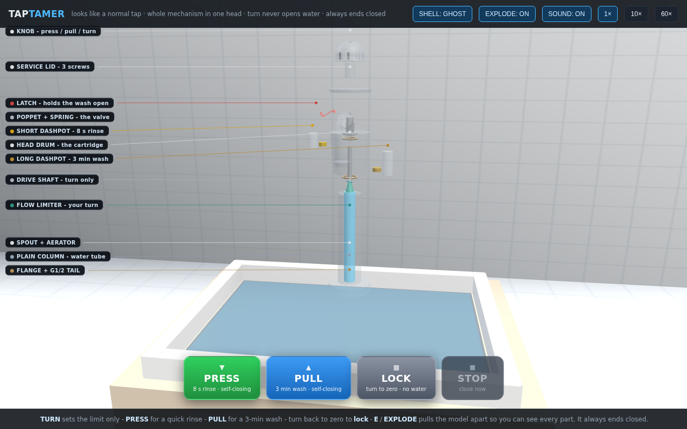
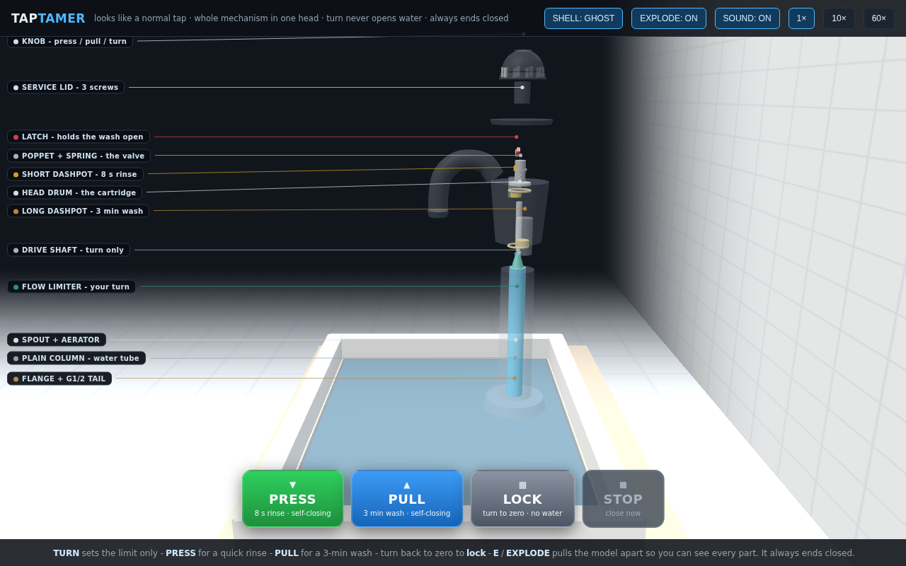
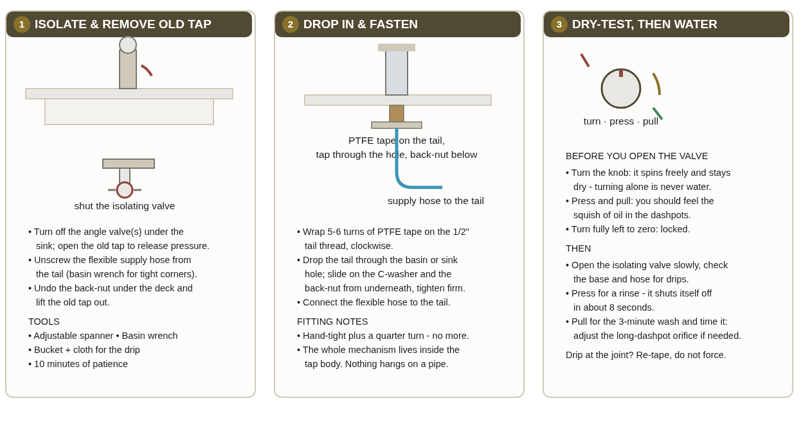

# 02 - Build Guide

The one and only build guide - plain Markdown, so it reads directly on GitHub,
including on phones where PDF previews often fail. Print settings match
`TapTamer.scad` and the six files in `stl/`.

## Tools you need

* 3D printer (0.4 mm nozzle)
* Drill + 3 mm bit (opens the dashpot orifices), the needle supplied with the
  oil can works as a reamer
* Screwdriver for 3 x M3
* PTFE tape, silicone grease
* Adjustable spanner / basin back-nut spanner for fitting

## 1. Print the parts

PETG, 0.2 mm layers, 4 walls for all wet parts. Supports only where noted.

| STL file | Part | Supports | Notes |
|---|---|---|---|
| `1_wet_body.stl` | Tail + flange + **plain column** + head drum + gooseneck spout + the head lid (prints beside the body) | Spout arc, tail | The column is empty on purpose - do not put anything inside it |
| `2_knob.stl` | Dome knob with square socket | No | Ream the square socket crisp |
| `3_limiter.stl` | Flow limiter: seat ring + needle cone + square drive rod, one piece | No | Light lapping of silicone grease on the cone seat |
| `4_poppet.stl` | Poppet disc + tube stem + flange | No | Face the disc with a 1/2" PTFE/rubber washer (19 x 12 mm is the standard size) |
| `5_dashpot_short.stl` | Short dashpot (tube + piston + orifice cap) | No | Charge with 350 cSt silicone oil |
| `6_dashpot_long_latch.stl` | Long dashpot + the latch lever + rocker lever | No | Same oil; orifice opens narrower |

## 2. The tail - make it a real G1/2 fitting

The tail boss prints with a bed for a brass **G1/2 (1/2" BSP) insert**. This is
the same thread as any ordinary pillar tap tail: G 1/2 measures 20.955 mm
across the threads with 14 threads per inch (pitch 1.814 mm), which is exactly
the thread your basin's back-nut and flexible hose expect.

1. Epoxy a 1/2" brass insert (or a cut-down 1/2" brass tank-connector tail)
   into the printed bed with a potable-water-rated epoxy putty - J-B Weld
   WaterWeld, PC-Plumbing or equivalent, all NSF-listed for drinking water.
2. Let it cure fully before it touches water (check the pack - typically
   1 hour to handle, 24 hours full cure).

## 3. Assemble the head cartridge

Everything happens inside the head drum - the column stays empty:

1. Drop the **flow limiter** (3) onto its spot on the chamber floor.
2. Fit the two **dashpots** (5, 6) to their bosses on the drum wall. Fill each
   tube about 70% with **350 cSt silicone shock oil**, then slide the piston
   and cap on with no air pocket. Open the orifice with the needle: about
   1.8 mm for the short one, about 1.1 mm for the long one.
3. Stand the **closing spring** on the limiter stem (a 12 x 1.2 x 45 mm
   compression spring, about 30 N - a standard hobby/printer-shop spring).
4. Lower the **poppet** (4) onto the spring, PTFE face down.
5. Fit the **head lid**: its seat ring is the poppet's seat, its boss guides
   the poppet stem, its pivot carries the rocker. Drive the 3 x M3 screws in.
6. Press the **knob** (2) onto the square drive rod.

Service check: undo 3 screws, lift the lid, and the whole cartridge lifts out
as one unit on the bench. That is the whole servicing story.

## 4. Fit it - swap the old tap

It is a complete replacement tap, so fitting is exactly what your old tap went
through, using the same parts sold in every plumbing aisle ("tap fixing kit"):

1. Isolate the water (angle valve under the basin / stop-cock).
2. Unhook the old tap's flexible hose, undo its back-nut, lift the old tap out.
3. Feed TapTamer's G1/2 tail through the **same 35 mm basin hole**.
4. Under the basin: top-hat washer + **brass back-nut** - tighten with a
   back-nut spanner. Same as always.
5. Reconnect the **same flexible hose** you already had - 1/2" BSP x M10 tap
   tails are the standard fitting. PTFE tape on the thread.
6. Turn the water back on and check for leaks around the back-nut first.

## 5. Commission it (2 minutes)

1. **Turn** the knob fully back to zero, then **press** it: nothing may come
   out. That proves the interlock - turning alone never opens water.
2. Turn to about half, press again: water runs, and must close by itself in
   about 8 seconds. Too fast? Trim the short dashpot's orifice narrower with
   the needle (oil side) or fit a slightly larger orifice to make it slower
   the other way - remember: wider = faster, narrower = slower.
3. **Pull** up for the wash and time it: it should bleed itself shut in about
   3 minutes. Trim the long dashpot's orifice the same way.
4. Turn fully back to zero: LOCK. Press all you like - nothing comes out.

## Troubleshooting

| Symptom | Cause | Fix |
|---|---|---|
| Weep past the poppet while closed | Disc face not sealing on the seat ring | Re-face with a fresh 19 x 12 mm washer, re-lap the seat with silicone grease |
| Rinse closes in 2 s | Short dashpot orifice too wide | Plug with a touch of melted filament, re-drill ~1.8 mm |
| Wash runs past 3 min | Long dashpot orifice too wide | Same, target ~1.1 mm |
| Knob turns but limit does not change | Square socket worn | Ream the socket, or print the knob again at 100.3% X/Y |
| No water at all, ever | Supply valve closed, or you are still in LOCK | Check under the basin; turn the knob off zero |

## Numbers worth knowing when you test

* US law (EPAct 1992, as updated) caps kitchen/lavatory faucets at
  **2.2 gpm = 8.3 L/min** - TapTamer's full-open rate (8 L/min in the
  simulator) is set just under that.
* EPA WaterSense labels lavatory faucets at **1.5 gpm = 5.7 L/min** - which is
  exactly what the simulator's default 50% limit gives you.
* A tap left running wastes **over 6 L/min** (UK water industry figure); a
  dripping tap wastes **at least 5,500 L/year**. TapTamer's worst case is one
  self-closing wash.

Sources for every number: [04 - Facts and Sources](04-FACTS-AND-SOURCES.md).
