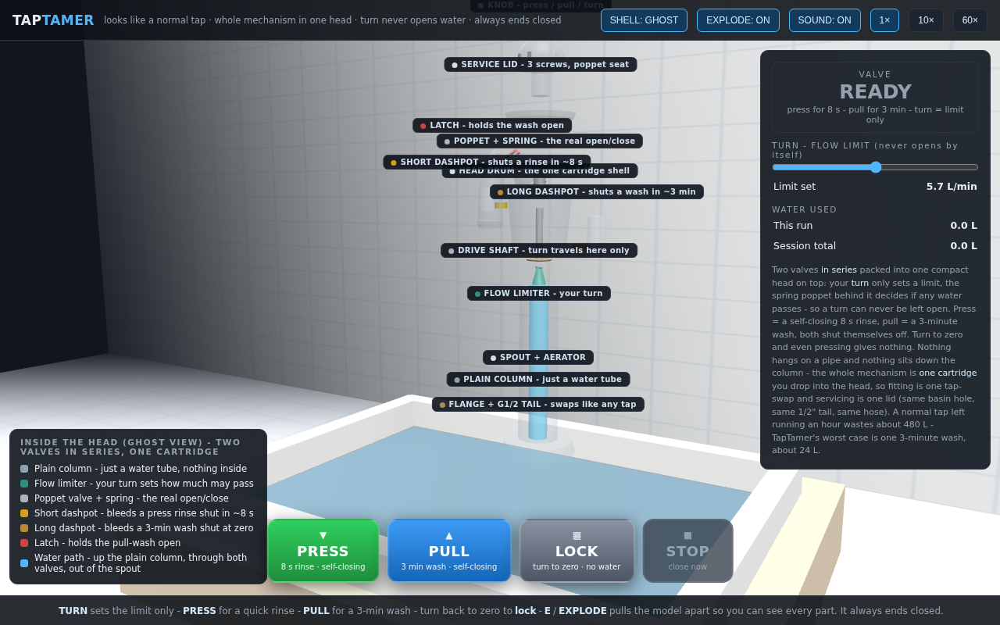

# 03 - Parts List: what it is on the model, what it is in real life

Every part on TapTamer is either a standard printed shape or an ordinary
plumbing/hobby item you can actually buy. Nothing needs machining, casting or
a specialist supplier. The design deliberately copies parts of real taps
(where the mechanism sits, the tail thread, the washer sizes) so that the
bought items are the same ones hardware shops already stock for ordinary taps.

## Printed parts (6 files in `stl/`)

| # | File | On the model | Real-world equivalent |
|---|---|---|---|
| 1 | `1_wet_body.stl` | Tail boss + flange + plain column + head drum + gooseneck spout (head lid prints beside it) | A pillar-tap body: same silhouette as any basin tap, same 35 mm hole, same G1/2 tail |
| 2 | `2_knob.stl` | Dome knob with grip ribs, square socket | Tap handle / joystick knob |
| 3 | `3_limiter.stl` | Seat ring + needle cone + square drive rod | A needle/globe valve trim - the standard way to meter flow |
| 4 | `4_poppet.stl` | Disc + tube stem + flange | A poppet valve, the same principle as a tap washer on a jumper valve |
| 5 | `5_dashpot_short.stl` | Tube + piston + orifice cap (~8 s) | Door closer / RC shock absorber, scaled down |
| 6 | `6_dashpot_long_latch.stl` | Same, ~3 min, plus latch lever and rocker | Same + the latch that holds a flush valve open |

## Bought parts - all standard, all findable

| Item | Exact spec to ask for | Qty | Where it is sold | Why this one |
|---|---|---|---|---|
| Brass tail insert | **G1/2 (1/2" BSP)** brass insert or short 1/2" brass tank-connector tail | 1 | Plumbing aisle, any hardware shop | G1/2 is THE tap tail thread: 20.955 mm over threads, 14 TPI, 1.814 mm pitch - same as every basin tap |
| Tap fixing kit | 1/2" **back-nut + top-hat washer** kit | 1 | Same aisle, sold as "tap fixing kit" / basin fixing kit | This is literally how normal pillar taps clamp to a basin - 32-30 mm back-nuts are standard items |
| Flexible tap connector | **1/2" BSP x M10** braided hose, 300-500 mm | 1 (or reuse your old one) | Every plumbing shelf | The standard tap tail hose; you can also just reconnect the hose the old tap used |
| Epoxy putty | **Potable-water-rated epoxy putty stick** - J-B Weld WaterWeld (NSF), PC-Plumbing (NSF) or Superfast Aqua PW | 1 stick | Hardware / plumbers' merchant | Seals the brass insert into the printed bed; NSF-listed = certified safe for drinking water |
| Closing spring | Compression spring **12 x 1.2 x 45 mm**, ~30 N | 1 | Spring packs, printer/hobby shops | Sized to close the poppet with margin at realistic supply pressures |
| Silicone oil | **350 cSt silicone shock oil** (RC damper oil; Tamiya #350, or any brand) | 1 small bottle | RC/hobby shops, toy shops, online | The damping medium; cSt grading is an industry standard - Tamiya's number IS the cSt value |
| PTFE face washer | **1/2" tap washer, 19 mm OD x 12 mm ID** (rubber or PTFE) | 2-3 | Plumbing aisle packs | The standard 1/2" washer size used on tap heads and hoses - it faces the poppet disc |
| Lid screws | **M3 x 10 mm** socket/head screws + washers | 3 | Any fastener pack | Close the service lid |
| PTFE tape | Standard 12 mm PTFE thread tape | 1 roll | Everywhere | On the G1/2 hose thread, as always |
| O-rings / grease | Nitrile O-rings to suit dashpot pistons + silicone grease | a few | Plumbing / hobby aisle | Piston sealing, cone lapping |

## Sourcing tips

* **Plumbing aisle** (back-nut kit, tail insert, hose, washers, PTFE tape,
  epoxy putty): ask for *"the fixing kit for a 1/2-inch pillar tap"*. These
  are exactly the parts your old tap was installed with - that is the whole
  point of the G1/2 tail design.
* **RC / hobby shop or toy shop** (350 cSt shock oil, the spring): ask for
  *"shock oil, 350 weight"*. Different brands grade oil in the same cSt scale,
  so any brand works.
* **Epoxy putty**: check the pack says potable/drinking-water safe (NSF or
  WRAS wording). WaterWeld and PC-Plumbing are the two most common worldwide.

## What is NOT on the list (on purpose)

* No batteries, electronics, magnets or clockwork.
* No proprietary cartridge - the head cartridge is entirely 3D-printed plus
  the bought items above.
* No adapters to modify your old tap: TapTamer replaces the old tap, it does
  not hang on it.
